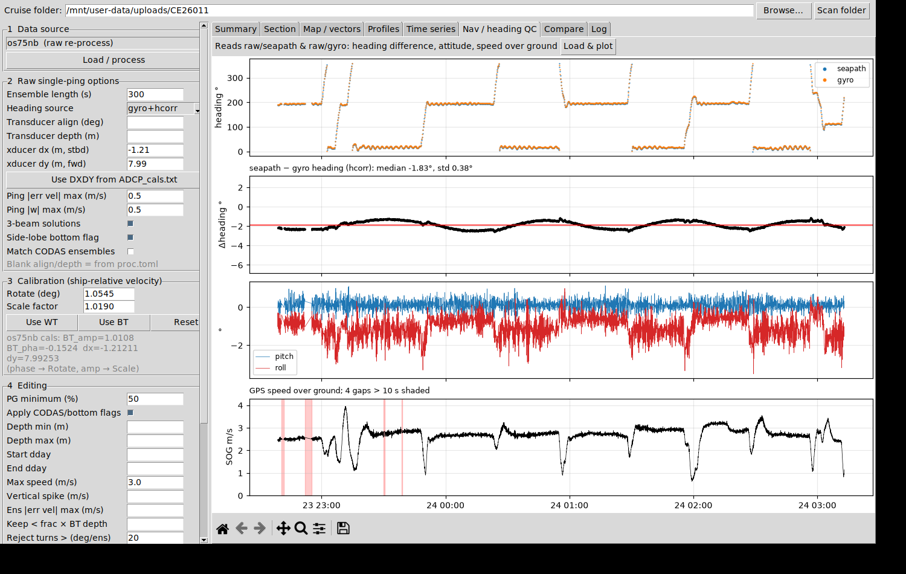

# Sruth VMADCP Processor

A desktop GUI for processing vessel-mounted ADCP data from **UHDAS / Teledyne RDI Ocean Surveyor** (os75bb / os75nb) cruise folders.
Point it at a cruise folder. It reads the CODAS output or the raw pings, then calibrates, edits, plots and exports.



## Installation
Requires Python 3.9+ with numpy, scipy and matplotlib. Tkinter ships with python.org Python.

```bash
git clone https://github.com/<your-user>/sruth-vmadcp-processor.git
cd sruth-vmadcp-processor
pip install -r requirements.txt
```

## Usage
```bash
python sruth_vmadcp_gui.py "path/to/CRUISE_FOLDER"
```
On Windows you can instead double-click `run_vmadcp_gui.bat`, or drag a cruise folder onto it. The .bat installs any missing packages.
Browse to the cruise folder, or paste its path, then click **Scan folder**.

The engine can also be used without the GUI:
```python
import sruth_vmadcp_core as core
cf  = core.CruiseFolder("path/to/CRUISE_FOLDER")
sec = core.load_codas(cf, "os75bb")                 # or core.process_raw(cf, {"pingtype": "bb"})
sec = core.apply_calibration(sec, rotate_deg=-0.06, scale=1.019)
core.apply_editing(sec, pg_min=50)
core.export_csv(sec, "os75bb.csv")
```

## Files it reads
| Path | Used for |
|---|---|
| `proc/<sonar>/contour/<sonar>.nc` | CODAS-averaged ensembles |
| `proc/<sonar>/contour/allbins_other.mat` | last-good-bin info |
| `raw/os75/*.raw` + `*.raw.log` | single-ping PD0 data (bb/nb interleaved) with PC timestamps |
| `raw/seapath/*.sea` | GGA position, HDT heading, PSXN,23 pitch/roll |
| `raw/gyro/*.hdg` | gyro heading |
| `raw/config/*_proc.toml` | h_align, transducer depth, ensemble length |
| `reports/ADCP_cals.txt`, `ADCP_settings.txt`, `uhdas_overview.txt` | WT/BT/DXDY calibrations and settings |

## Workflow (left panel)
1. **Data source**: pick CODAS netCDF, or re-process from raw pings (bb or nb).
2. **Raw options**: ensemble length, heading source (gyro+seapath hcorr / seapath / gyro), alignment, transducer depth, dx/dy lever arm (you can fill these from ADCP_cals), single-ping error-velocity and w limits, 3-beam solutions, side-lobe bottom flag, and matching the CODAS ensemble boundaries.
3. **Calibration**: rotation and scale applied to ship-relative velocity. The WT and BT buttons fill these in from ADCP_cals.txt.
4. **Editing**: PG, flags, depth window, time window, max speed, vertical spike, error velocity, fraction of the BT depth, and turn rejection.
   - Start/End time (UTC) accepts `2026-09-24 01:30`, `2026-09-24T01:30:00`, `24/09/2026 01:30`, a date alone (a bare end date means the end of that day), `HH:MM` (placed on the dataset's first day, or the next day if that time is before the data starts), or decimal day.
   - **Fill full range** puts the data's start and end in the boxes. **Clear times** empties them. Profiles outside the window are removed from the plots and the exports.
5. **Compare / export**: load a second dataset to compare against. Export writes CSV, NetCDF, MAT, PNGs and a processing report to `<cruise>/sruth_processed/<sonar>_<source>_<timestamp>/`.

Tabs: Summary, Section (any variable vs time/lon/lat/distance), Map/vectors (layer mean), Profiles, Time series, Nav/heading QC, Compare, Log.

## Raw processing chain
PD0 beam velocities → instrument frame (30° convex Janus, with optional 3-beam solutions) → earth frame using heading + h_align → single-ping QC → vector average over each ensemble. Ship velocity comes from GPS displacement across the ensemble, and absolute velocity = relative + ship. PG is the percentage of good pings. The bottom is flagged from BT (from the nb pings) using the cos(30°) side-lobe limit.
The ping type is read from the fixed-leader mode byte (1 = bb, 10 = nb). This matters because the OS writes a single active ping type under the 0x0000 IDs.

Validation (Celtic Explorer CE26011, os75bb): raw re-processing with CODAS-matched ensembles and no extra calibration gives a bias of ≤0.5 cm/s and an rms difference of 4–5 cm/s against the CODAS netCDF.
The remaining differences come from CODAS reference-layer ship-speed smoothing and CODAS editing.

## Limits
- Pitch and roll are not used in the transformation, matching UHDAS for the OS.
- No reference-layer (refsm) smoothing of ship velocity is applied.
- Editing in the CODAS netCDF is fixed: the short form already has flagged cells removed.
  Rotation and scale are applied on top. For a full CODAS rerun, use quick_adcp.py (pycurrents).

## Repository layout
| File | Purpose |
|---|---|
| `sruth_vmadcp_gui.py` | Tkinter GUI |
| `sruth_vmadcp_core.py` | Processing engine: PD0 reader, NMEA readers, beam→earth transform, ensemble averaging, calibration, editing, export |
| `run_vmadcp_gui.bat` | Windows launcher |
| `docs/` | Screenshot |

Survey data are not included. `.gitignore` blocks raw, netCDF and MAT files so they can't be committed by accident.

## License
MIT, see [LICENSE](LICENSE).

## Author
Dr Luke O'Reilly, Sruth Marine
